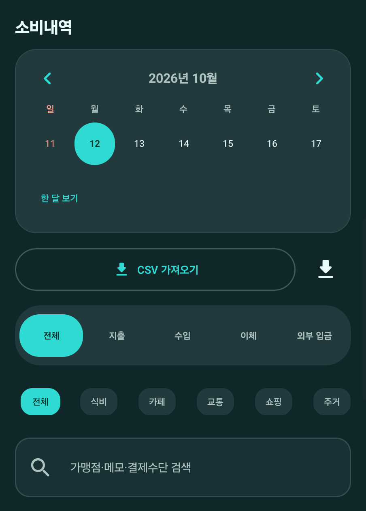

# 모아씀 v0.1.37 — 내역 달력 선택 표시 개선

- 실제 Fold4에서 위플과 모아씀의 대시보드·내역·함께 시작·관리 화면을 대조했습니다.
- 내역 달력에서 선택한 날짜가 원형 배경의 위쪽에 붙어 보이던 정렬 오류를 수정했습니다. 날짜 숫자는 원의 중앙에 오고, 거래가 있는 날의 점 표시는 아래쪽에 따로 나타납니다.
- 모아씀의 월 목표 지출과 고유 테마, 무료 시작 흐름은 유지했습니다.

## 검증

- JVM 단위 테스트 217개 통과, 실패 0개.
- Galaxy Z Fold4 계측 테스트 17개 중 16개 통과. 원격 Supabase 로그인 테스트 1개는 opt-in 자격 증명이 없어 건너뛰었습니다.
- `testDebugUnitTest`, `connectedDebugAndroidTest`, `lintDebug`, `lintVitalRelease`, `assembleDebug`, `assembleRelease` 통과. lint 오류 0개, 기존 경고 24개.
- QA 앱의 내역 달력에서 선택 날짜 중앙 정렬을 실기기로 확인했습니다. v0.1.36 → v0.1.37 업데이트 후 새 기능 팝업이 실제 화면 캡처·설명과 함께 표시되는 것도 확인했습니다.
- 운영 앱 패키지는 Weeple 비교 목적으로 업데이트하지 않았습니다.
- APK: `com.moasseum.app`, versionCode 37, versionName 0.1.37, 59 MB. SHA-256: `8cddf5519c63a6e6e3dad30d46f950a4ae89d93a65bb4eeb7bffcca9c1f13249`.
- APK 서명 인증서 SHA-256: `669674a2114fb59d85c56bba774b89fec9ce7f7ee79825769826130362a091c9` (기존 공개 앱과 동일).
배포: 배포 완료 후 링크를 기록합니다.
