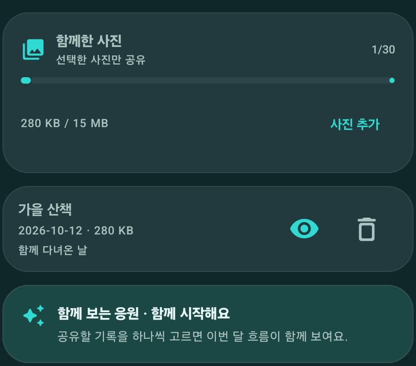
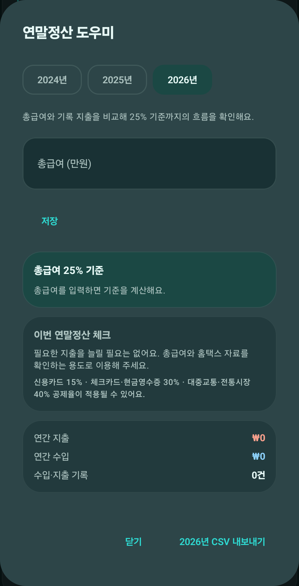
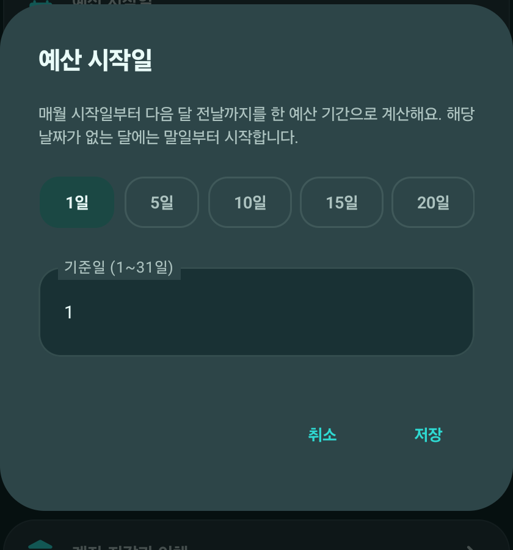
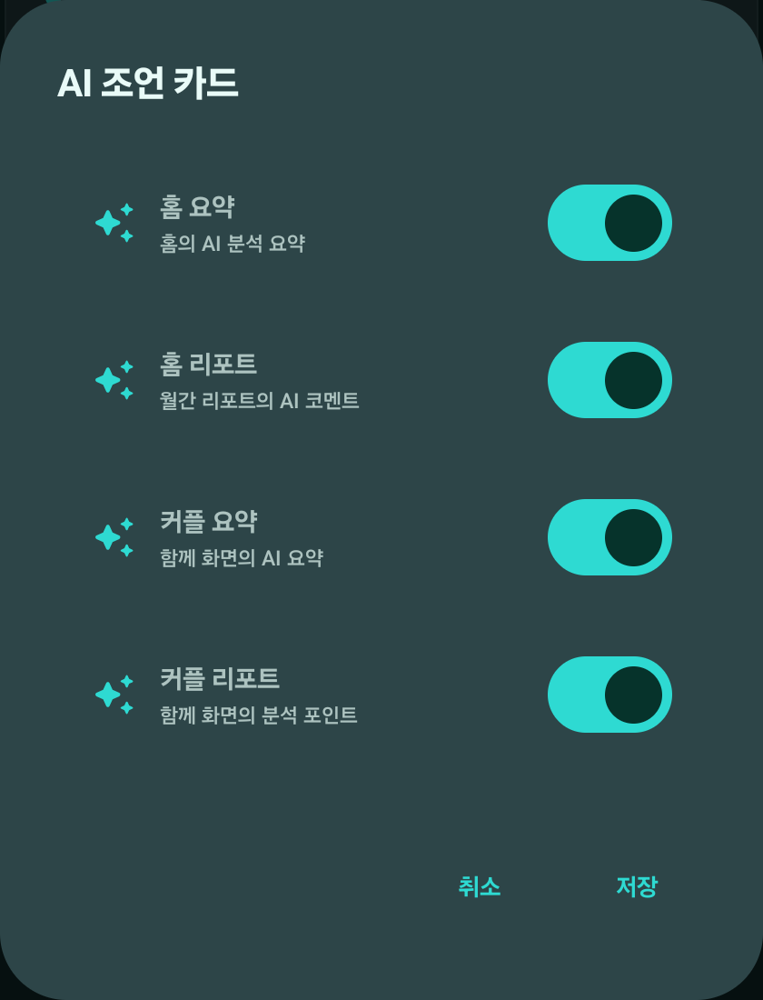

# 모아씀 v0.1.38 — 함께한 사진, 급여일 예산, AI 설정

이번 업데이트는 무료로 제공됩니다. 아래 이미지는 Galaxy Z Fold4의 QA 앱에서 실제 화면을 캡처한 것입니다. 사진 앨범의 예시 기록은 테스트용 가상 항목이며 운영 계정 사진이 아닙니다.

## 함께한 사진과 기념일

- 공유 장부에서 직접 고른 사진만 함께 볼 수 있는 앨범을 추가했습니다.
- 업로드 전에 EXIF 위치정보를 제거하고 JPEG로 재인코딩합니다. 1장당 최대 1 MiB, 장부당 30장·15 MiB까지 저장합니다.
- 비공개 Storage와 멤버 전용 정책을 적용했습니다. 다른 장부 구성원은 사진을 볼 수 없습니다.
- 기념일 전날·당일 알림 및 함께 보는 응원 카드를 추가했습니다.

## 급여일 예산과 연말 기록

- 매월 예산 시작일을 정할 수 있습니다. 예산 진행액·남은 금액·일일 사용 가능액·예상액과 알림이 선택한 주기를 따릅니다. 해당 날짜가 없는 달은 말일부터 시작합니다.
- 시작일은 설정 백업/복원에도 포함됩니다.
- 총급여 25% 기준과 연간 지출·수입·거래 기록을 확인하고 CSV로 내보낼 수 있습니다. 세금 공제액·환급액을 계산하지 않으며, 세금 신고를 대신하지 않습니다.

## AI 조언과 거래 입력

- 홈 요약·홈 리포트·함께 요약·함께 리포트를 각각 켜고 끌 수 있고 전체 백업/복원에 반영됩니다.
- AI 거래 문장에 결제수단을 직접 적으면 해당 결제수단을 거래 후보에 반영합니다.
- 앱 내 구독·결제 잠금은 두지 않습니다. AI 서버/Google 제공량과 운영상 보호 제한은 적용됩니다.

## 개인정보 및 운영 설정

- 운영 Supabase에 승인된 사진 테이블·RLS·비공개 버킷 정책을 적용했습니다. 기존 거래나 사진을 자동으로 업로드하지 않았고, 실제 사진 데이터를 추가하지 않았습니다.
- 사진은 사용자가 선택해 공유를 시작할 때만 업로드됩니다. 사용자는 앨범에서 사진을 보고 삭제할 수 있습니다.
- APK 설치 업데이트는 Android 시스템 설치 확인이 필요할 수 있으며, 무인/무음 설치는 지원하지 않습니다.

## 검증 및 배포

- Android 단위 테스트 232개 및 Galaxy Z Fold4 계측 테스트 18개 통과. 원격 Supabase Auth 테스트 1개는 테스트 계정 미설정으로 건너뛰었습니다.
- `:app:lintDebug`, `:app:lintVitalRelease`, `:app:assembleRelease` 통과. Cloudflare Worker 타입 검사와 20개 테스트 통과, 배포 후 `/health` 응답에서 인증 필수 상태를 확인했습니다.
- 앱 ID `com.moasseum.app`, versionCode `38`, versionName `0.1.38`.
- APK SHA-256: `478a86f2bbe63ee7bfe87fc01f17a5cd2e9102a1d9699c9ff18cdc1c5c209b44`.
- 서명 인증서 SHA-256: `669674a2114fb59d85c56bba774b89fec9ce7f7ee79825769826130362a091c9` (공개 v0.1.37과 동일).
- [GitHub에서 v0.1.38 APK 받기](https://github.com/blossom0948/gagebu2/releases/download/v0.1.38/app-release.apk) · [릴리스 페이지](https://github.com/blossom0948/gagebu2/releases/tag/v0.1.38).
- 업데이트는 앱 안에서 APK를 내려받은 뒤 Android 설치 확인 화면에서 사용자가 설치를 승인해야 합니다. 무음 자동 설치는 지원하지 않습니다.
